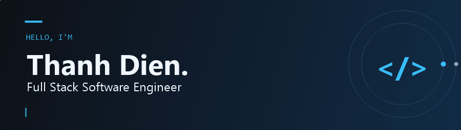
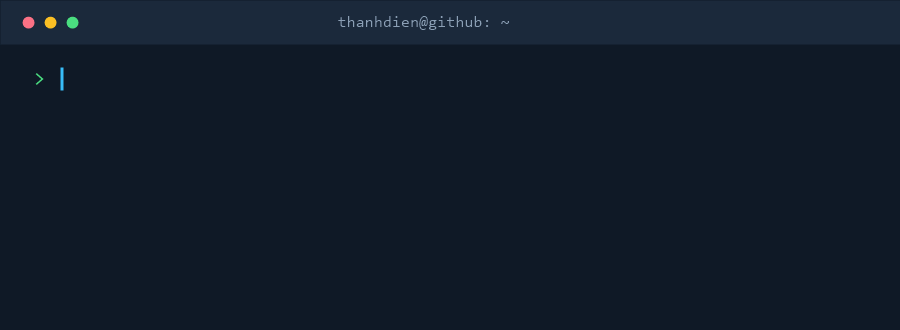
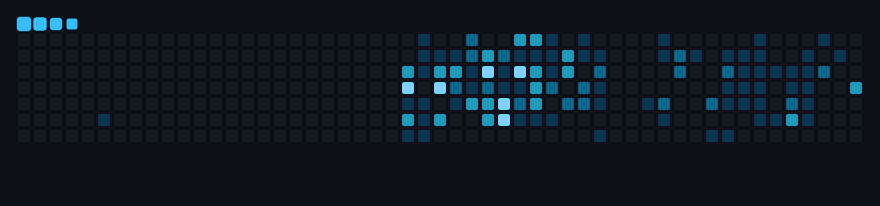

  

  
  

## 👨‍💻 Behind the code

  

<b>From an idea to something you can use.</b> I enjoy connecting interfaces, logic, and data to build useful software.

## ⚡ My developer toolkit

Eight technologies I've learned and practiced — across the web and beyond.

<table align="center">
  <tr>
    <td align="center" width="420">
      <h3>🌐 Web development</h3>
      
      
HTML · CSS · JavaScript · PHP

      Structure · Style · Interaction · Server logic
    </td>
    <td align="center" width="420">
      <h3>🧩 Programming languages</h3>
      
      
C · C++ · Python · Java

      Problem solving · Algorithms · Application logic
    </td>
  </tr>
</table>

## Contribution Snake

  

---

  Thanks for stopping by. Explore my pinned repositories below ↓

  

